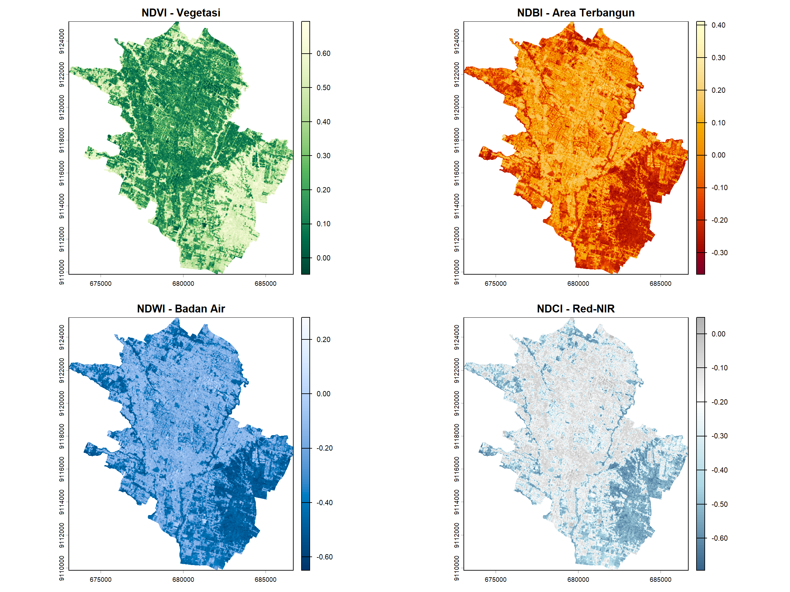
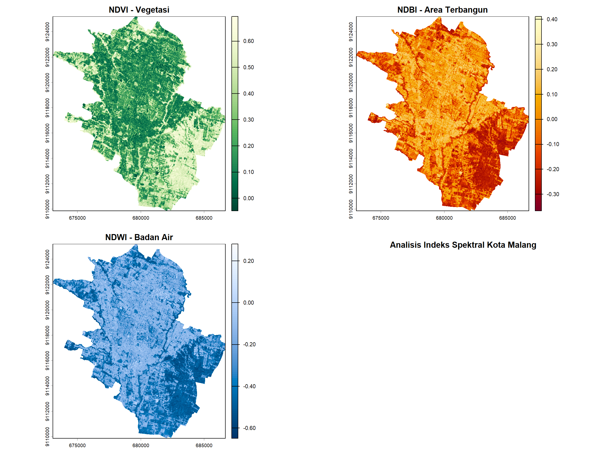

# Output Hasil Pengolahan - zakwanzufar86

Dokumen ini berisi daftar output hasil pengolahan data spasial dan citra yang tersimpan di dalam folder `output/`.

---

## 📷 Output Gambar

### 1. 4 Indeks Malang

### 2. Citra Malang

---

## 🎥 Output Video

https://github.com/meWaann/zakwanzufar86/raw/main/output/WhatsApp%20Video%202026-10-17%20at%2020.35.58.mp4

> *Catatan: Klik tautan di atas untuk memutar/mengunduh video.*

---

## 📁 File Data & GeoTIFF (Unduh)

Klik tautan di bawah ini untuk mengunduh file data spasial dan tabel hasil pengolahan:

* 📄 **Klasifikasi Tutupan Lahan (.tif):** [Unduh File](output/Klasifikasi_Tutupan_Lahan.tif)
* 📄 **NDBI Malang (.tif):** [Unduh File](output/NDBI_malang.tif)
* 📄 **NDCI Cloud Malang (.tif):** [Unduh File](output/NDCI_Cloud_Malang.tif)
* 📄 **NDVI Malang (.tif):** [Unduh File](output/NDVI_malang.tif)
* 📄 **NDWI Malang (.tif):** [Unduh File](output/NDWI_malang.tif)
* 📄 **Citra Malang (.tif):** [Unduh File](output/citra_malang.tif)
* 📊 **Zonal Statistics Malang (.csv):** [Unduh File](output/Zonal_Statistics_Malang.csv)
